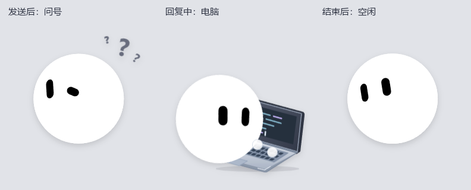

# bot 桌宠 🐾

[English](README.en.md) · [下载 Windows 版](https://github.com/XiangquanRuan/bot-desktop-pet/releases/latest)

一个白球黑眼的 Windows 桌面伙伴。可以点击互动、拖动、贴边半隐藏，也能跟随 Grok Bot 当前会话显示思考和工作动作。没有 Grok 时，同样可以作为普通桌宠使用。



## 功能

- **Grok 状态联动**：发送消息后冒问号；思考时保持疑惑；调用工具或生成回复时使用电脑；结束后自动恢复空闲。
- **两个小球手打字**：侧视笔记本、两个圆球交替敲键盘，没有手臂；偶尔停顿抬头。电脑不会遮挡 bot 的脸和身体。
- **点击与拖动**：空闲时单击触发随机动作；拖动时睁大眼睛、拉长并轻微倾斜，松手恢复。
- **四边半隐藏**：拖到屏幕工作区域边缘松手，只露半个头；拖回恢复。贴边时暂停自动跳动。
- **托盘菜单**：指定动作、8 种款式、11 种颜色、8 种空闲表情、大小、跳动开关、找回位置和退出。
- **托盘连接提示**：绿点表示 Grok 已连接，灰点表示未连接；悬停可看文字状态。
- 默认窗口为 **132 × 140 个 Windows 逻辑像素**，没有底部文字标签；位置和外观会保存。

当前应用菜单为中文；本仓库提供中英文使用和开发说明。

## 下载与运行

1. 在 [Releases](https://github.com/XiangquanRuan/bot-desktop-pet/releases/latest) 下载 `bot-desktop-pet-windows-x64.zip`。
2. **完整解压**，不要只拷贝一个 exe。
3. 直接运行文件夹里的 `bot.exe`，或运行 `Install.cmd` 安装并创建桌面快捷方式。

安装不需要管理员权限。更新前先从托盘退出旧版。程序未进行代码签名；如果系统策略禁止安装脚本，可以直接运行解压目录中的 `bot.exe`。

| 操作 | 效果 |
| --- | --- |
| 单击 bot | 空闲时随机动作 |
| 按住拖动 | 移动，显示被拎起的效果 |
| 拖到四边后松手 | 半隐藏 |
| 右键 bot / 托盘 | 指定动作、换肤和其他设置 |
| 托盘“恢复完整显示” | 解除半隐藏 |
| 托盘“找回桌宠位置” | 移回主屏幕可见区域 |
| “动作预览 → 电脑工作” | 不发消息即可预览电脑动作 |

没有设置开机自启动。

## 连接 Grok Bot

适配和实际验证版本：**Grok Bot 0.78.1、Windows x64**。联动依赖该版本窗口结构，后续 Grok 更新可能需要适配；它不是 Grok 官方 API 或官方插件。

安装脚本会给桌面已有的 `Grok Bot.lnk` 增加这两个参数：

```text
--remote-debugging-address=127.0.0.1 --remote-debugging-port=19222
```

退出 Grok 后，从该快捷方式重新启动一次。也可以在 bot 托盘中选择“打开 Grok Bot”，默认查找 `%LOCALAPPDATA%\Programs\Grok Bot\Grok Bot.exe`。

若 Grok 安装在其他位置，可在它的快捷方式目标后手动添加上述参数。已经启动但没有带参数的 Grok，需要退出后重开；无需重启整个电脑。

### 状态读取与本机数据

- 使用本机 Chromium 调试连接，每 250 毫秒采样，只将当前会话的活动状态交给桌宠，不需要 API Key。
- 优先跟随当前打开的会话，排除旧缓存，识别回合结束和等待用户确认，避免一直敲电脑。
- 问号提示至少保留约 0.9 秒，避免快速回复让思考提示完全闪过。未获确认的发送等待最多保留 12 秒；连接断开会恢复空闲。
- 此项目不修改 Grok 的程序文件，不上传会话内容，也不包含登录信息。它会监听输入框提交事件并读取已有界面的状态对象；本机诊断文件仅保存状态、数量及时间等元数据。
- 启用调试参数后，本机进程可以访问该调试端口。仅绑定 `127.0.0.1`，不要转发该端口或绑定公网地址。不使用联动时，可以从 Grok 快捷方式中移除参数并重启 Grok；普通桌宠功能不受影响。

## 源码运行

需要 Node.js **22.12+** 和 npm。在仓库根目录执行：

```powershell
npm ci
npm run build
npm test
npm start
```

首次安装会下载 Electron。网络环境需要镜像时，可以在当前终端设置 `ELECTRON_MIRROR` 后重新执行 `npm ci`；项目不包含代理设置或任何凭据。

### 构建 Windows 下载包

在 Windows 上执行：

```powershell
npm run package
```

输出位于 `release/bot-desktop-pet-windows-x64.zip`。`release/`、依赖和构建结果不提交到 Git，下载包通过 GitHub Releases 分发。

### 检查

```powershell
npm test        # 14 项状态、会话结束及屏幕边缘逻辑检查
npm run build   # TypeScript / Vue 检查和 Vite 构建
npm run test:ui # Windows 实际窗口检查；需要先 build，会短暂显示测试桌宠
```

窗口检查使用隔离配置，并把截图和结果写入 `test-artifacts/ui/`，不会覆盖日常桌宠设置。验证记录见 [docs/VALIDATION.md](docs/VALIDATION.md)。CI 会执行自动化检查和构建；维护者可推送 `v*` 版本标签，或手动运行 “Publish Windows release” 工作流发布下载包。

## 目录

```text
electron/       窗口、托盘、Grok 状态读取、状态切换、检查
src/            Vue / SVG 动画与桌宠交互
assets/         应用、快捷方式与托盘图标
scripts/        打包、安装和窗口检查入口
docs/           截图、验证记录与发布说明
```

## 本机文件与卸载

- 安装目录：`%LOCALAPPDATA%\Programs\bot`
- 设置、位置和诊断：`%APPDATA%\bot-desktop-pet`
- 卸载：从托盘退出，删除安装目录及桌面 `bot.lnk`。需要清空设置时，再删除上述设置目录。若不再使用 Grok 联动，移除其快捷方式里的调试参数并重启 Grok。

## 许可与致谢

使用 MIT 许可。动画内核基于 Jérémy Perret 的 [bloub](https://github.com/jeremy-prt/bloub)，包含用户提供的白球黑眼改版。原始版权与许可保留在 [LICENSE.bloub](LICENSE.bloub)，依赖和归属说明见 [THIRD_PARTY.md](THIRD_PARTY.md)。本项目与 Grok、xAI 没有官方隶属关系。
